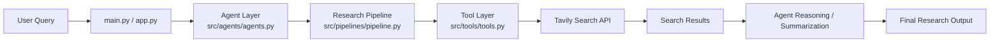

# 🚀 MultiAgent Research Assistant (LangChain)

<p align="center">
  
  
  
</p>

A lightweight multi-agent research assistant built with Python and LangChain, designed to gather, analyze, and summarize web content using autonomous agent workflows and external search tools.

This project demonstrates a practical architecture for agentic research: multiple specialized agents collaborate to process a user query, retrieve relevant information, and produce structured outputs.

## 🌐 Overview

The application is intended for research-heavy workflows where the system can:

- accept a user research question or topic
- perform targeted web searches
- retrieve relevant content
- structure and summarize findings
- prepare final research output for downstream use

## ✨ Key Features

- Multi-agent architecture using LangChain agents
- Web search integration with Tavily
- Python-based implementation for easy experimentation
- Environment-based configuration using `.env`
- Modular project structure for expansion into more tools and workflows
- Extensible research pipeline for web retrieval and summary generation

## 🛠️ Technology Stack

- Python 3.11
- LangChain and LangChain Core
- LangChain Community / OpenAI integration
- Tavily API for search
- Requests for HTTP interactions
- Python Dotenv for environment management
- BeautifulSoup / lxml / Trafilatura for content parsing and processing
- Streamlit (included for UI-based experimentation and demos)

## 📁 Project Structure

```text
MultiAgent_Research_Assistant_LangChain/
├── app.py                          # App entry or UI wrapper
├── main.py                        # Main execution entry point
├── requriements.txt               # Dependency list
├── README.md                      # Project documentation
├── LICENSE                        # License information
├── src/
│   ├── __init__.py
│   ├── agents/
│   │   ├── __init__.py
│   │   └── agents.py             # Agent orchestration and behavior
│   ├── pipelines/
│   │   ├── __init__.py
│   │   └── pipeline.py           # Research pipeline logic
│   └── tools/
│       ├── __init__.py
│       └── tools.py              # Tavily search and external tools
├── .env                           # Local environment variables (not committed)
└── .env.example                   # Optional example env file
```

## 🏗️ Project Architecture

The project follows a modular, agent-first architecture designed to separate responsibilities across layers:



### Architecture Components

- `src/tools/tools.py` contains external tool integrations such as web search and retrieval logic.
- `src/agents/agents.py` defines the agent layer responsible for reasoning, task routing, and orchestration.
- `src/pipelines/pipeline.py` is intended to coordinate the flow from query to research result.
- `main.py` is the entry point used to trigger the research workflow.
- `app.py` can be extended into a UI or application wrapper.

In a typical workflow, a user prompt enters the system, a research-focused agent decides how to answer, a tool such as Tavily executes a search, and the retrieved results are passed to the reasoning layer for summarization and final output generation.

## ✅ Prerequisites

Before you begin, ensure you have:

- Python 3.11 installed
- Conda or a virtual environment manager
- An API key for Tavily
- Optional: OpenAI or another LLM provider key if you extend the project to use LLM-backed agents

## ⚙️ Installation

### 1. Clone the Repository

```bash
git clone https://github.com/Rahulbandi97/MultiAgent_Research_Assistant_LangChain.git
cd MultiAgent_Research_Assistant_LangChain
```

### 2. Create and Activate a Virtual Environment

Using conda:

```bash
conda create -n langagent python=3.11 -y
conda activate langagent
```

If `conda` is not recognized, verify it with:

```bash
conda --version
```

If needed, initialize Conda in your shell first:

```bash
source "/c/Users/username/anaconda3/etc/profile.d/conda.sh"
conda --version
```

### 3. Install Dependencies

```bash
pip install -r requriements.txt
```

> Note: This repository currently includes a file named `requriements.txt` with a spelling variation of `requirements`. It is included as-is for compatibility with the current project.

### 4. Configure Environment Variables

Create a `.env` file in the project root:

```env
TAVILY_API_KEY=your_tavily_api_key_here
```

If you use additional LLM providers, add their keys as needed.

## ▶️ Running the Project

To run the project entry point:

```bash
python main.py
```

This may trigger a sample research call, depending on the current implementation state.

## 💡 Example Usage

The project is designed to support prompts such as:

```python
from src.tools.tools import web_search

result = web_search("What is the latest research on AI?")
print(result)
```

## 🗺️ Roadmap

Planned improvements may include:

- agent memory and conversation persistence
- better summarization pipelines
- structured output formatting
- source citation support
- web scraping and article extraction for deeper analysis
- UI layer with Streamlit or FastAPI
- advanced multi-agent collaboration and task decomposition

## 🤝 Contributing

Contributions are welcome.

If you would like to contribute:

1. Fork the repository
2. Create a feature branch
3. Commit your changes
4. Open a pull request with a clear summary of the improvement

## 📄 License

This project is licensed under the MIT License. See the [LICENSE](LICENSE) file for details.

## 📬 Contact

For questions, suggestions, or collaboration opportunities, please open an issue or reach out through the repository's GitHub project page.

## 🙏 Acknowledgements

- LangChain community for the agent tooling ecosystem
- Tavily for search integration
- Open-source contributors and the broader AI research ecosystem

